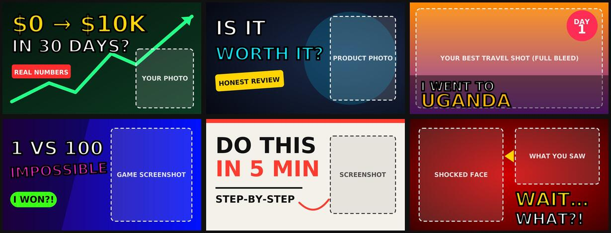

# Free YouTube Thumbnail Templates 🎬

Six bold, click-ready YouTube thumbnail templates (1280×720). Free to use, easy to edit in **Photopea** (free, in your browser), Figma, Inkscape or Illustrator.

## What's inside

| Template | Best for | File |
|---|---|---|
| $0 → $10K | Finance, side hustles, money | `01-finance-money.svg` |
| Is It Worth It? | Tech and product reviews | `02-tech-review.svg` |
| I Went To… | Travel vlogs | `03-travel-vlog.svg` |
| 1 vs 100 | Gaming | `04-gaming.svg` |
| Do This In 5 Min | Tutorials and how-tos | `05-tutorial-howto.svg` |
| Wait… What?! | Reactions and storytime | `06-reaction-shock.svg` |

## How to use (2 minutes, free)

1. Download the `.svg` you like (open it, then click **Download raw file**).
2. Go to [photopea.com](https://www.photopea.com) and drag the file in.
3. Change the words to match your video. Keep them to 3 to 5 words.
4. Drop your photo or screenshot over the dashed box, then delete the box.
5. **File → Export as → PNG** and upload it to YouTube.

**Tips that get clicks:** big readable text, one emotion on your face, high contrast, and nothing important in the bottom-right corner (YouTube puts the video length there).

## Want a custom thumbnail instead? 👋

I'm **Kissa**, a graphic designer from Uganda. I'll design a custom, click-worthy thumbnail built around your video's hook.

- **Order on SproutGigs:** [I will design a click-worthy YouTube thumbnail](https://sproutgigs.com/g/65e1ddebc2b4/i-will-design-a-click-worthy-youtube-thumbnail?a=1a77486e)
- **See my work:** [Portfolio](https://hark.site/s/cd7ed1e7-38b7-4465-80f7-01b72ff484b7)
- **Email:** kissa101421@gmail.com

⭐ If these templates helped you, star this repo so other creators can find it.

## License

Free for personal and commercial use under [CC BY 4.0](https://creativecommons.org/licenses/by/4.0/). A credit or a link back to this repo is appreciated.
